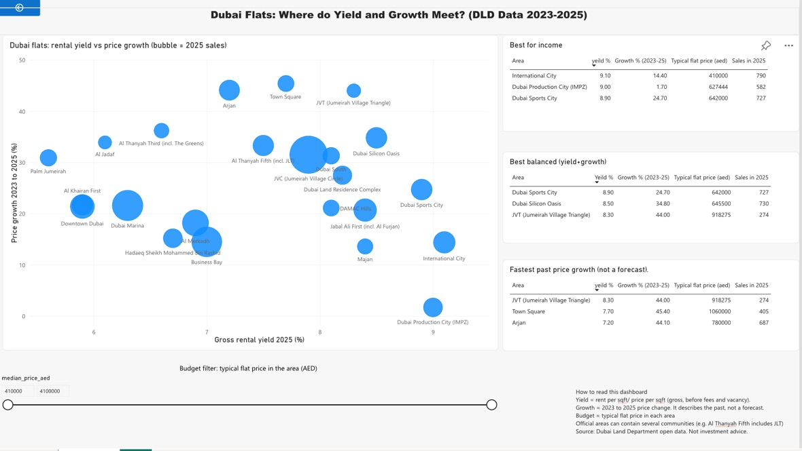

# Dubai Flats: Where Do Yield and Growth Meet?

**Question:** Across Dubai's residential areas, where do flat buyers get the best rental yield and price growth, and does a simple ranking hold up when tested on later data?

**Tools:** SQL (SQLite), Python (pandas, scikit-learn, matplotlib), Power BI
**Data:** Dubai Land Department open data via Dubai Pulse (sales transactions and Ejari rent contracts, extracted 7 Oct 2026). Period analysed: Jan 2023 to Sep 2026 (2026 is a partial year).

## Key findings

1. **Income:** the highest 2025 gross yields were in affordable areas: International City (9.1%), Dubai Production City (9.0%) and Dubai Sports City (8.9%). Prime areas such as Dubai Marina (6.3%), Downtown (5.9%) and Palm Jumeirah (5.6%) yielded less.
2. **A high yield alone can mislead:** Dubai Production City yields 9.0% but its prices rose only 1.7% from 2023 to 2025.
3. **Balanced picks:** Dubai Silicon Oasis (8.5% yield, +34.8% price growth) and JVT (8.3%, +44.0%).
4. **Backtest:** picks made with 2023-24 data only were judged on 2025. Income and balanced picks beat the other areas by about 6-7 percentage points of total return (22.8% and 23.4% vs 16.3% and 16.0%). Growth-based picks did not (18.7% vs 18.4%). Yield was stable year to year (rank correlation 0.81); past growth was not (0.15). So the dashboard labels growth as "past growth, not a forecast".
5. **Fair-value model:** a gradient boosting model predicting price per sqft was off by a typical 8.8% on held-out flats, against 27.3% for a naive single-price guess (R2 = 0.82). Area was by far the biggest driver, about 3x more important than size.
6. **Metro check (null result):** flats with a metro label cost 46% more per sqft citywide (AED 1,386 vs 950), but within the same area the gap disappeared (median ratio 0.94, 5 areas). The citywide gap reflects location, not the station.

## Data cleaning decisions

| Step | Decision | Why |
|---|---|---|
| Sales | Kept transactions of type "Sales" only (687,909 of 899,437) | Mortgages and gifts are not purchase prices |
| Sales | Kept residential flats and villas, Jan 2023 to Sep 2026 | Same period as rents; removes typos such as the year 1416 |
| Sales | Removed duplicates and the top and bottom 1% of price per sqft | Outliers |
| Rents | Kept flats and villas in the same period | Same scope as sales |
| Rents | Kept single-property contracts only | A first version gave yields of up to 43% because some contracts covered whole buildings with one unit's size |
| Rents | Kept rent per sqft between AED 20 and 250 | Sanity limits |
| Yield | Existing properties (sales) vs new contracts (rents), same year | Off-plan costs more and renewals are cheaper |
| Units | Converted sqm to sqft | Dubai market convention |

Final clean records: **260,727 sales** and **185,607 rent contracts**.

## How the yield and growth were calculated

- **Gross yield** = median new-contract annual rent per sqft / median price per sqft, per area and year.
- **Growth** = change in median price per sqft, 2023 to 2025.
- Areas need enough deals: 100+ sales and rents in 2025 and 100+ sales in 2023 for the recommender (23 areas qualify).
- **Income, balanced and growth scores** are percentile ranks. Balanced weights yield 60% and growth 40%, a judgement informed by the backtest.

## Limitations

- Yields are **gross**: service charges, fees and vacancy are not deducted.
- The backtest has **one test year (2025)** and 36 areas, so it is suggestive, not proof. 2025 was a rising market.
- Median price per sqft can move because different flats sold, not only because prices changed.
- No data on floor, view, condition or service charges. Flagged deals are "unusual", not proven bargains.
- Official DLD areas can contain several communities (for example Al Thanyah Fifth includes JLT, Jumeirah Islands, Jumeirah Park and Jumeirah Heights). Results are for the whole official area.
- The metro column holds only a station name, not a distance, so a true proximity effect cannot be tested.
- Villa sizes may reflect plot rather than built-up area, so the analysis focuses on flats.
- Not investment advice.

## Repository contents

- `notebooks/`: Python scripts (cleaning, model, backtest, recommender, dashboard data)
- `sql/`: SQL queries for yield by area and by year
- `charts/`: yield vs growth chart, backtest chart, dashboard screenshot
- `data/`: small summary tables used by the dashboard

The raw DLD files are too large for GitHub. Download the transactions and rent contracts from Dubai Pulse (dubaipulse.gov.ae), place them in `data/raw/`, and run the scripts in `notebooks/` in this order: `clean.py`, `fix_rent.py`, then `sql/build_db.py`, `area_summary.py`, `model.py`, `backtest.py`, `recommender.py`. Paths in the scripts assume the project sits in a folder called `dubai-property-fair-value` on the Desktop.

## Dashboard

Built in Power BI (online): a yield vs growth scatter chart, a budget filter on the typical flat price in each area, and top-3 rankings for income, balanced and growth investors.

## Note

Built as a portfolio project with AI assistance for coding. The analytical choices, data checks and conclusions are my own.
